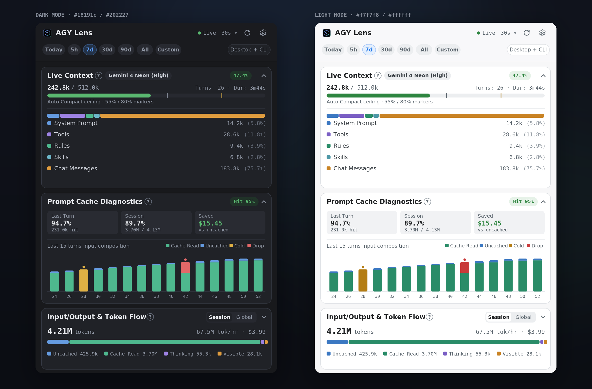
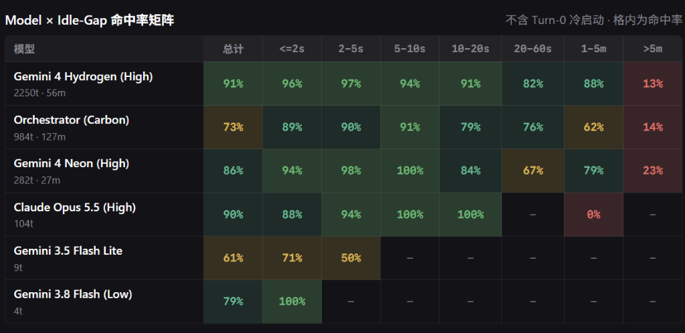
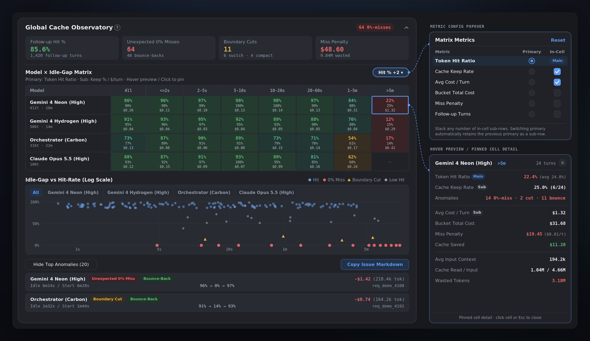
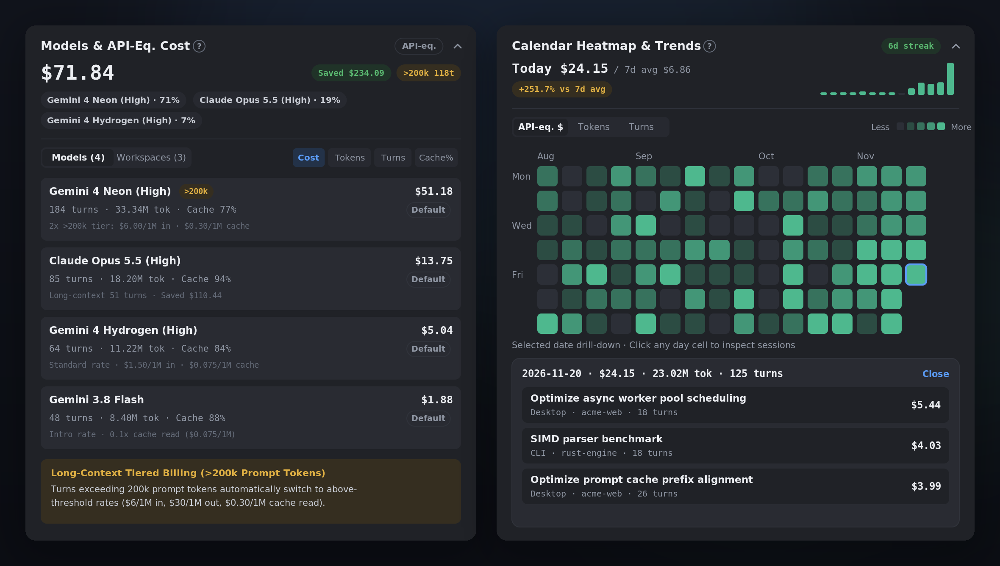

<p align="center">
  
</p>

<h1 align="center">AGY Lens</h1>

<p align="center">
  <strong>Local-first, strictly read-only telemetry sidecar for Antigravity Desktop &amp; CLI.</strong><br />
  Live context composition, prompt cache diagnostics, cross-session cache-miss observatory, long-context API-equivalent cost analytics, 16-week usage heatmap, and 2-decimal manual quota alignment.
</p>

<p align="center">
  <strong>English</strong> | <a href="README.zh-CN.md">简体中文</a>
</p>

<p align="center">
  
  
  
  
  
</p>

<p align="center">
  
</p>

---

## Why AGY Lens?

Many community usage extensions probe undocumented internal RPC endpoints, inspect OAuth tokens, or run background OS daemons that poll continuously even when hidden. **AGY Lens** takes the opposite approach:

- **Strictly Local & Read-Only**: Opens Antigravity Desktop (`~/.gemini/antigravity/conversations/*.db`) and CLI (`~/.gemini/antigravity-cli/conversations/*.db`) SQLite databases exclusively with `{ readOnly: true }`, parsing Protobuf step blobs directly in pure Node.js 24 (`node:sqlite`, zero npm dependencies).
- **Zero RPC Scraping / Zero Account Risk**: Never probes private host endpoints, never touches OAuth credentials, and never phones home (optional pricing catalog sync is off by default).
- **Visibility-Gated Zero Idle Overhead**: Built on Antigravity's native `sidecar_sdk` auxiliary pane lifecycle—automatically pauses all polling when the pane is collapsed or hidden.
- **Host-Synced Adaptive Theme**: Probes Antigravity's live CSS custom properties (`--background`, `--card`, `--primary`, etc.) so dark and light themes adapt automatically without manual theme toggles.

---

## Modular Feature Showcase

AGY Lens ships with **7 independently toggleable and reorderable modules**. Keep your sidebar minimal with live context only, or enable deep cross-session diagnostics whenever needed.

### 1. Live Context, Prompt Cache & Token Flow (Auxiliary Pane)

Shown above in the dual-theme hero preview:
- **Live Context**: Tracks tokens against the model's **Auto-Compact ceiling** (with `55%` caution and `80%` high-pressure ticks) and breaks down usage across `System Prompt`, `Tools`, `Rules`, `Skills`, `Subagents`, and `Chat Messages`.
- **Prompt Cache Diagnostics**: Displays last-turn hit ratio, session cumulative cache hit rate, estimated USD saved vs. uncached baseline, and a seamless **15-turn stacked bar chart** highlighting `Cold` starts and sudden `Drop` events.
- **Input/Output & Token Flow**: Splits tokens across 4 buckets (`Uncached In`, `Cache Read`, `Thinking Out`, `Visible Out`) with `Session | Global` scope switching and average `TTFT / Gen` latency.

### 2. Global Cache Observatory (Module #6)

Diagnose cross-session prompt-cache instability—such as idle-gap TTL decay, transient routing misses, and prefix boundary cuts—with a single anonymized report generator.

**Live Production Capture (`Model × Idle-Gap` Hit-Rate Matrix):**

<p align="center">
  
</p>

**Full Observatory Layout (KPIs + Matrix + Log Scatter + Top Anomalies):**

<p align="center">
  
</p>

- **4 Health KPI Tiles**: Follow-up Hit %, Unexpected `0%` Misses (with **Bounce-Back** recovery count), Boundary Cuts (excluding intentional model switches and compactions), and estimated Miss Penalty USD.
- **Model × Idle-Gap Hit-Rate Matrix**: Buckets consecutive turn pairs across `<=2s`, `2-5s`, `5-10s`, `10-20s`, `20-60s`, `1-5m`, and `>5m` to expose model-specific decay (e.g., mid-gap drops vs. steady `99%+` models).
- **Idle-Gap vs. Hit-Rate Log Scatter Plot**: Filterable by model, visually separating normal hits, `0%` misses, boundary cuts, and low-hit turns on a logarithmic time axis.
- **Top Anomalies & `Copy Issue Markdown`**: Inspect `prev → miss → next` hit transitions, `Idle Gap` vs. `Start Gap`, and export a **privacy-sanitized** Markdown table ready for GitHub issues.

### 3. Models, Long-Context Cost & 16-Week Calendar Heatmap (Modules #4 & #5)

<p align="center">
  
</p>

- **Models & API-Eq. Cost**: Aggregates compute value by model or workspace, computes cache savings, and automatically applies **>200k tiered long-context pricing** on turns exceeding 200k prompt tokens (`>200k` badge).
- **16-Week Calendar Heatmap & Day Drill-Down**: Tracks active day streaks, Today vs. 7-day average deltas, 14-day sparkbars, and a crisp 1:1 pixel heatmap (`API-eq. $ | Tokens | Turns`). Click any day cell to drill down into that date's sessions and costs.

### 4. Manual Quota Alignment & Cycle Budget Inversion (Module #7)

Because Antigravity exposes no official Sidecar Quota API, AGY Lens keeps quota tracking 100% compliant via **2-decimal manual alignment anchors** (`e.g. 94.25%`).

<p align="center">
  
</p>

- **Single-Cycle `7d` Focus & 2-Decimal Precision**: Auto-detects step precision (`1%`, `0.1%`, or `0.01%`), defaults to `7d`, and scopes both anchor history and calibration strictly to the current active cycle (older cycles stay cleanly collapsed).
- **Automatic Reset-Cycle Inheritance**: Leave the reset countdown blank when logging another checkpoint inside the same active cycle to inherit the cycle's prior `reset_at` timestamp automatically (or enter a new value if an early reset occurred).
- **Progressive Weight Calibration Lab (`L0 → L1 → L2 → L3`)**: Shares default Base anchors with `pricing_defaults.json` (`defaultAnchors`) and lets you switch the `1.00×` Base model right in the UI; as you collect varied single-cycle segments, a profile-grid WLS + LOOCV + `VIF < 10` selector progressively unlocks model multipliers (`w_m`), cache-read multiplier (`α_cache`), and output multiplier (`α_out`), with an Observed vs. Predicted (`pp`) residual chart.

### 5. Settings Drawer, Self-Explaining `?` Help & Bilingual UI

<p align="center">
  
</p>

- **7 Independent Modules & Reordering**: Enable/disable and reorder (`↑ / ↓`) any module; disabled modules skip scanning and backend queries completely.
- **Built-in `?` Help Tooltips**: Every module header and settings control carries an interactive `?` callout explaining *what it shows*, *when to enable*, and *exact scan scope*.
- **Instant Bilingual Switch**: Toggle `English` / `中文` anytime (`?lang=en` / `?lang=zh-CN` URL override also supported for previews).

---

## Privacy & Compliance Guarantee

| Aspect | AGY Lens Guarantee |
| :--- | :--- |
| **Conversation DB Access** | Opened strictly with `new DatabaseSync(path, { readOnly: true })` (WAL-aware incremental mtime/size indexing; never writes to source DBs). |
| **Host RPC & Auth Tokens** | **Zero** internal RPC probing, **zero** OAuth/credential file reads, **zero** undocumented host endpoint calls. |
| **Background Execution** | Runs solely as an Antigravity-managed UI sidecar (`on-failure`); polling pauses automatically when the pane is hidden (`Off` / `15s` / `30s` / `60s` / `5m`). |
| **Local Cache Storage** | Incremental index, settings, pricing overrides, and quota anchors live locally under `~/.gemini/antigravity/sidecar_data/agy-lens/lens_panel/data/`. |
| **Issue Report Export** | `Copy Issue Markdown` strips workspaces, local paths, and conversation titles—emitting only aggregated stats, model IDs, gap durations, and provider request IDs. |

---

## Installation & Updates

### Option A: Clone Directly into Antigravity Plugins (Recommended)

```bash
git clone https://github.com/xukp20/agy-lens.git ~/.gemini/config/plugins/agy-lens
agy plugin validate --strict ~/.gemini/config/plugins/agy-lens
```

Or install from a local clone via CLI:

```bash
git clone https://github.com/xukp20/agy-lens.git /tmp/agy-lens
agy plugin install /tmp/agy-lens
```

> **Note**: Requires Antigravity `2.22+` (Sidecar Web UI support) and Node.js `24+` (built-in `node:sqlite`). No `npm install` step is needed.

### Quick Update from GitHub

If you installed via `git clone` into `~/.gemini/config/plugins/agy-lens`:

```bash
git -C ~/.gemini/config/plugins/agy-lens pull --ff-only
agy plugin validate --strict ~/.gemini/config/plugins/agy-lens
```

---

## Customizing Model Pricing

AGY Lens uses a **3-tier pricing resolution engine** (`sidecars/lens_panel/lib/pricing.mjs`):

1. **User Overrides (`pricing_overrides.json`)** — Highest precedence. Edit per-model input, output, thinking, cache-read, cache-write, and `>200k` long-context tiered rates directly in the **Settings → Pricing Management** UI (or reset back to default anytime).
2. **Bundled Date-Versioned Defaults (`sidecars/lens_panel/lib/pricing_defaults.json`)** — Built-in offline baseline covering Gemini 4, Gemini 3.8, and Claude 5.5 tiers including scheduled effective dates and `>200k` multipliers.
3. **Optional Remote Sync (`remote_pricing_cache.json`)** — Disabled by default for 100% offline operation. Enable **Auto-Sync Remote Pricing** (24h TTL) or click **Sync Pricing Now** to refresh public reference prices from LiteLLM / OpenRouter JSON catalogs.

---

## Local Architecture & Data Flow

```text
  Read-Only Source DBs (mode=ro)              AGY Lens Sidecar (Node.js 24)
  ──────────────────────────────              ─────────────────────────────
  ~/.gemini/antigravity/                      sidecars/lens_panel/
   └─ conversations/<uuid>.db   ──┐            ├─ lib/protobuf.mjs    (raw wire decode)
                                  ├─(ro)────▶  ├─ lib/indexer.mjs     (WAL incremental index)
  ~/.gemini/antigravity-cli/      │            ├─ lib/pricing.mjs     (3-tier + >200k rates)
   └─ conversations/<uuid>.db   ──┘            ├─ lib/cache_observatory.mjs
                                               ├─ lib/quota.mjs       (2-decimal CI budget)
                                               └─ main.mjs            (SidecarApp REST API)
                                                     │
                                                     ▼  127.0.0.1 HTTP + /preload.js theme tokens
                                               web/{index.html,styles.css,app.js}
                                               (Antigravity Aux Pane — 7 modular cards)
```

---

## Local Demo Mode & Screenshot Tools

Preview the full AGY Lens UI in any browser using anonymized synthetic telemetry—no local Antigravity databases required:

```bash
node scripts/demo_server.mjs --port 4318
```

Then open:
- Dark Mode (English): `http://127.0.0.1:4318/?theme=dark&lang=en`
- Light Mode (中文): `http://127.0.0.1:4318/?theme=light&lang=zh-CN`

### Regenerating Documentation Screenshots

- **Zero-browser 2x Retina previews** (`cairosvg` + `Pillow`):
  ```bash
  python3 scripts/render_previews.py
  ```
- **Optional real-browser Playwright capture** (on machines with Chromium):
  ```bash
  npm install --no-save playwright && npx playwright install chromium
  node scripts/capture_screenshots.mjs --out assets/screenshots/live
  ```

---

## Acknowledgements & Inspiration

AGY Lens stands on the shoulders of pioneering local-first telemetry work across the Antigravity and AI coding CLI ecosystem:

- **[`ahmetdotsh/agy-context`](https://github.com/ahmetdotsh/agy-context) & [`ahmetdotsh/agy-usage`](https://github.com/ahmetdotsh/agy-usage)** — Pioneered strictly local, read-only SQLite + Protobuf inspection for Antigravity conversation databases.
- **OpenAI Codex CLI (`/status` & `/usage`) & [`steipete/CodexBar`](https://github.com/steipete/CodexBar)** — Inspired the clean separation between live session telemetry and account-level quota tracking, the `Left / Used` perspective switch, and Even-Use pace indicators.
- **`cc-switch` & `ccusage`** — Inspired multi-source (`Desktop + CLI`) toggles, editable model pricing overrides, 4-bucket token flow breakdowns, and daily usage calendar heatmaps.
- **Antigravity Built-in `swarm_board` Sidecar** — Reference pattern for `SidecarApp` lifecycle, `/preload.js` luminance probing, and zero-flicker host CSS token synchronization.
- **[`google-antigravity/antigravity-cli#1533`](https://github.com/google-antigravity/antigravity-cli/issues/1533)** — Community prompt-cache telemetry discussions that inspired Module #6 (Global Cache Observatory): `Model × Idle-Gap` hit matrices, boundary-cut thresholds, bounce-back classification, and anonymized `Copy Issue Markdown`.

---

<p align="center">
  Released under the <a href="LICENSE">MIT License</a>.
</p>
