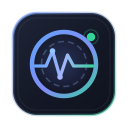
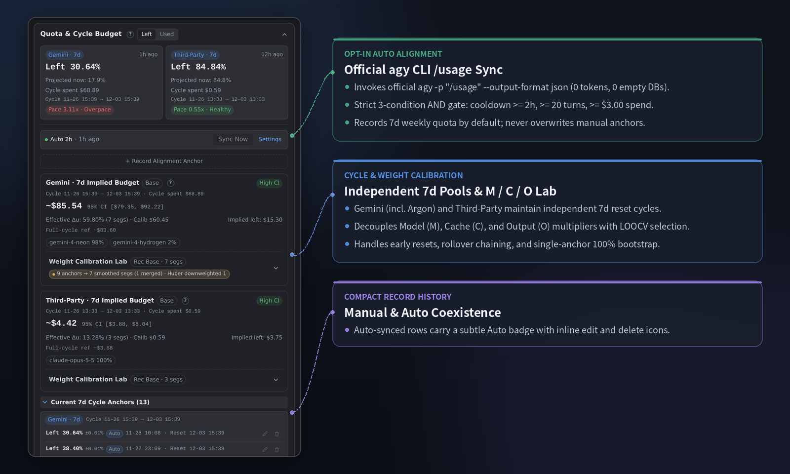
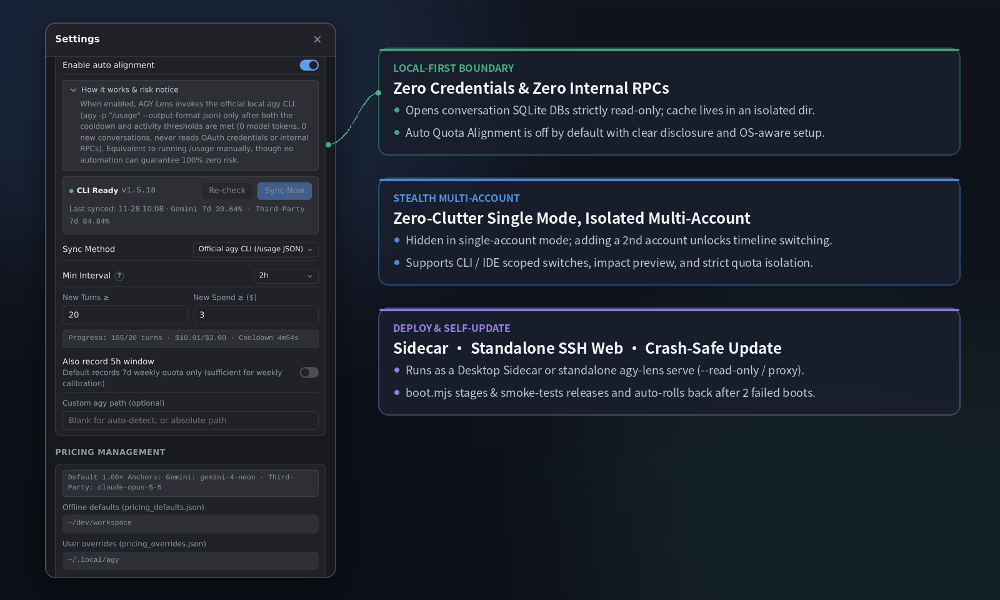

<p align="center">
  
</p>

<h1 align="center">AGY Lens</h1>

<p align="center">
  <strong>Local-first, strictly read-only telemetry sidecar for Antigravity Desktop &amp; CLI.</strong><br />
  Live context breakdown, prompt cache diagnostics, cross-session cache observatory, weekly quota alignment, API-equivalent cost analytics, and request speed — built with zero npm dependencies.
</p>

<p align="center">
  <strong>English</strong> | <a href="README.zh-CN.md">简体中文</a>
</p>

<p align="center">
  
  
  
  
</p>

<p align="center">
  
</p>

---

## Why AGY Lens?

- **Focused & Native Craft**: Built specifically around the signals that matter every day — session context, prompt cache behavior, weekly quota budgets, and API cost/speed — in a clean dark/light UI that inherits Antigravity's native tokens.
- **Strictly Read-Only & Low-Risk**: Opens Antigravity conversation databases read-only, never reads OAuth credential files, and never probes undocumented internal host RPC services.
- **Zero External Runtime Dependencies**: Runs purely on Node.js 24+ built-ins (`node:sqlite`, `node:http`, vanilla JS/CSS) — no `npm install` or build step required.
- **Desktop Sidecar + Standalone SSH Web**: Works natively inside Antigravity Desktop's auxiliary pane and also runs headless via `agy-lens serve` over SSH or reverse proxy.

---

## Core Capabilities

### 1. Live Context, Prompt Cache & Token Flow

Inspect the active session's 7-category prompt breakdown (`System`, `Subagents`, `Skills`, `Plugins`, `Rules`, `Tools`, `Chat Messages`), auto-compact `55% / 80%` markers, per-turn cache hit & savings, and 4-bucket token flow (`Uncached`, `Cache Read`, `Thinking`, `Visible`).

- Deep dive: [Live Context & Cache Guide](docs/live-context.md)

### 2. Global Cache Observatory

<p align="center">
  
</p>

- **`Model × Idle-Gap` Matrix & Log Scatter**: Pinpoint cache decay across idle intervals with customizable primary/sub-metrics, pinned cell details, time-series trends, and period comparisons.
- **Anomaly Triage & Sanitized Export**: Separates model switches and compaction from unexpected `0%` misses and bounce-backs, with one-click anonymized `Copy Issue Markdown`.
- Deep dive: [Cache Observatory Guide](docs/cache-observatory.md)

### 3. Quota Alignment & Cycle Budget Calibration

<p align="center">
  
</p>

- **Independent `7d` Cycles & `M / C / O` Lab**: Tracks **Gemini** (including Argon) and **Third-Party** pools independently, with precision-aware cycle splitting, early-reset support, single-anchor bootstrap, and orthogonal `Model / Cache / Output` weight calibration.
- **Opt-In Auto Quota Alignment (Default OFF)**: Optionally invokes official local `agy -p "/usage" --output-format json` (`0` model tokens, `0` new conversation DBs) behind a strict 3-condition AND gate (`cooldown >= 2h`, `>= 20 turns`, `>= $3.00` spend), coexisting cleanly with manual anchors.
- Deep dive: [Quota Alignment Guide](docs/quota-alignment.md)

### 4. API-Equivalent Cost, 16-Week Heatmap & Request Speed

<p align="center">
  
</p>

- **Long-Context Pricing & Calendar Heatmap**: Pure API-equivalent cost accounting with built-in defaults, optional remote sync, local overrides, and a clickable 16-week daily heatmap.
- **On-Demand Request Log & Speed**: SQL-paginated single-row feed with model/source/miss/slow filters, `TTFT`, Decode & End-to-End `TPS`, and **`Token-Weighted` | `Per-Req P50`** speed summaries.
- Deep dive: [Cost & Request Speed Guide](docs/cost-and-speed.md)

### 5. Settings, Stealth Multi-Account & Crash-Safe Updates

<p align="center">
  
</p>

- **Zero-Clutter Multi-Account**: Hidden in single-account mode; adding a 2nd account unlocks purely local switch timelines (`All` / `CLI` / `Desktop`), impact previews, and strict per-account quota isolation.
- **In-Panel Auto-Update & Standalone Web**: `boot.mjs` stages & smoke-tests releases with automatic rollback after startup failures; also runs headless via `agy-lens serve --read-only` or SSH port forwarding.
- Deep dive: [Settings, Multi-Account & Deployment Guide](docs/settings-and-deploy.md)

---

## Privacy & Security Guarantee

| Aspect | AGY Lens Guarantee |
| :--- | :--- |
| **Conversation DBs** | Opened strictly with `new DatabaseSync(path, { readOnly: true })`; never writes to Antigravity source DBs. |
| **Credentials & RPC** | **Zero** OAuth/credential file reads, **zero** undocumented local host RPC probing. |
| **Optional Network** | In-panel auto-update only `GET`s public GitHub Releases over strict HTTPS allowlists (`Settings → Off` for 100% offline). Pricing sync and Auto Quota Alignment (`agy -p "/usage"`) are both disabled by default. |
| **Local Data Isolation** | Cache DB, settings, pricing overrides, and quota anchors live in `~/.gemini/antigravity/sidecar_data/agy-lens/lens_panel/data/`, physically isolated from plugin code. |
| **Issue Export** | `Copy Issue Markdown` strips workspace paths, filenames, and conversation titles automatically. |

---

## Quick Start & Installation

### Option A: Antigravity Desktop Plugin (Recommended)

```bash
git clone https://github.com/xukp20/agy-lens.git ~/.gemini/config/plugins/agy-lens
agy plugin validate --strict ~/.gemini/config/plugins/agy-lens
```

Then enable **AGY Lens** in Antigravity Desktop → Plugins Manager and open the auxiliary side pane.

### Option B: Standalone Web Dashboard / Headless SSH (Node.js 24+)

```bash
# Loopback web dashboard (http://127.0.0.1:4318)
npx agy-lens serve

# Strictly read-only mode (blocks all mutating routes with HTTP 403)
npx agy-lens serve --read-only

# Headless CLI status summary
npx agy-lens status --json
```

See [Settings, Multi-Account & Deployment Guide](docs/settings-and-deploy.md) for release archives, reverse-proxy subpath auth, and local data layout.

---

## Documentation Index

| Topic | English | 简体中文 |
| :--- | :--- | :--- |
| Live Context, Cache & Token Flow | [docs/live-context.md](docs/live-context.md) | [docs/zh-CN/live-context.md](docs/zh-CN/live-context.md) |
| Global Cache Observatory | [docs/cache-observatory.md](docs/cache-observatory.md) | [docs/zh-CN/cache-observatory.md](docs/zh-CN/cache-observatory.md) |
| Quota Alignment & Calibration | [docs/quota-alignment.md](docs/quota-alignment.md) | [docs/zh-CN/quota-alignment.md](docs/zh-CN/quota-alignment.md) |
| Cost, Heatmap & Request Speed | [docs/cost-and-speed.md](docs/cost-and-speed.md) | [docs/zh-CN/cost-and-speed.md](docs/zh-CN/cost-and-speed.md) |
| Settings, Multi-Account & Deploy | [docs/settings-and-deploy.md](docs/settings-and-deploy.md) | [docs/zh-CN/settings-and-deploy.md](docs/zh-CN/settings-and-deploy.md) |
| Contributing & Feedback | [CONTRIBUTING.md](CONTRIBUTING.md) | [CONTRIBUTING.zh-CN.md](CONTRIBUTING.zh-CN.md) |

---

## Feedback, Contributing & Acknowledgements

- **Issues & Feature Requests**: Open a [GitHub Issue](https://github.com/xukp20/agy-lens/issues/new/choose) for bugs, model pricing updates, or new capabilities.
- **Contributing**: See [CONTRIBUTING.md](CONTRIBUTING.md) for local tests (`node --test scripts/test_*.mjs`) and design principles.
- **Inspiration**: Grateful to [`ahmetdotsh/agy-context`](https://github.com/ahmetdotsh/agy-context), [`ahmetdotsh/agy-usage`](https://github.com/ahmetdotsh/agy-usage), [`steipete/CodexBar`](https://github.com/steipete/CodexBar), `cc-switch`, `ccusage`, and the community discussions in [`antigravity-cli#1533`](https://github.com/google-antigravity/antigravity-cli/issues/1533).

<p align="center">
  Released under the <a href="LICENSE">MIT License</a>.
</p>
