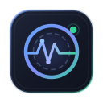
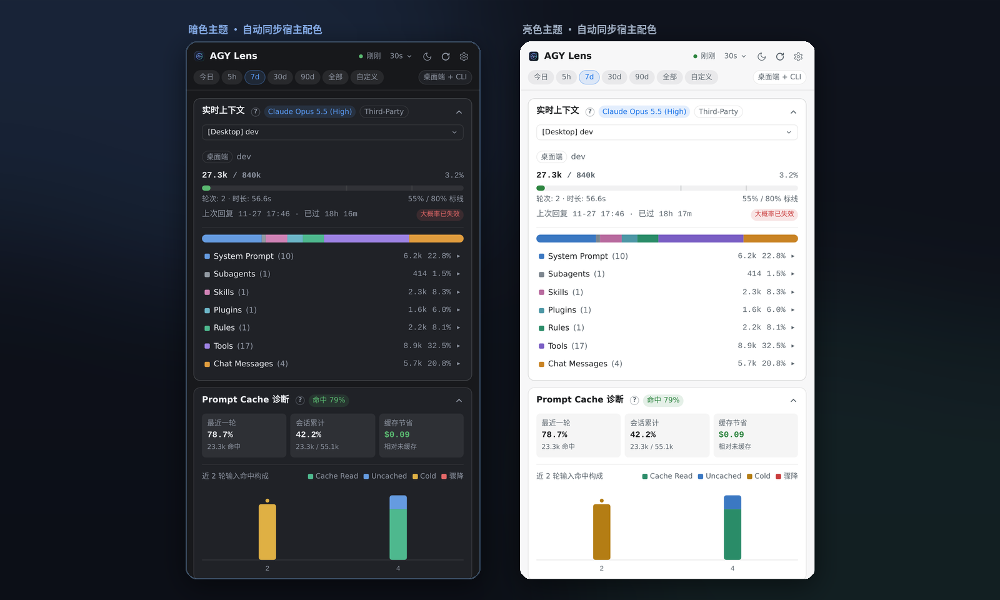
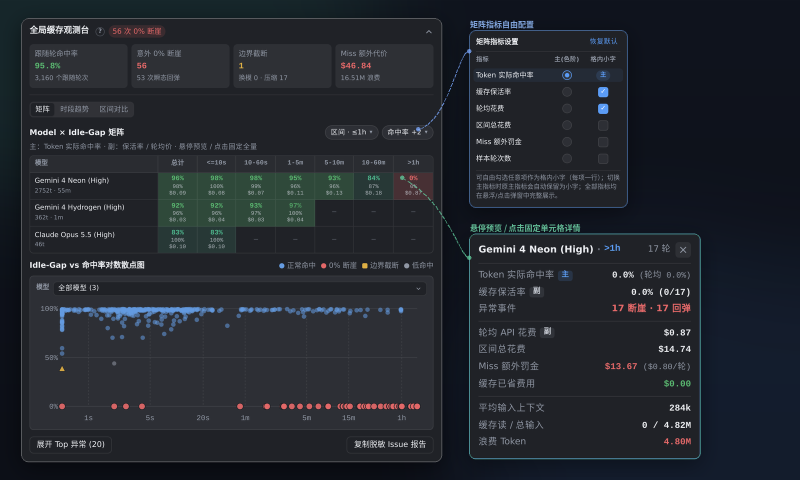
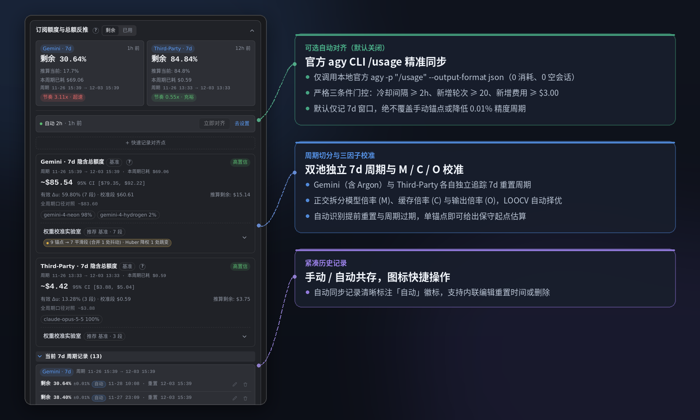
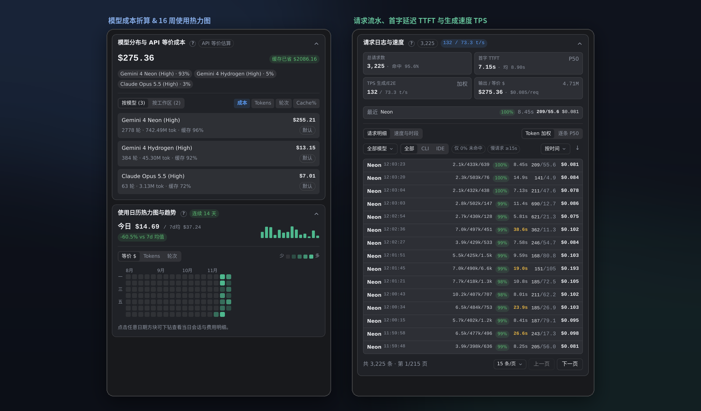
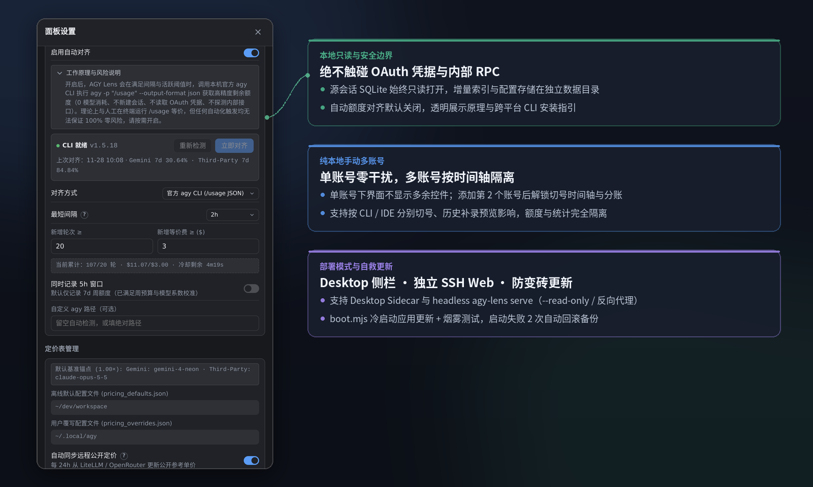

<p align="center">
  
</p>

<h1 align="center">AGY Lens</h1>

<p align="center">
  <strong>本地优先、严格只读的 Antigravity Desktop &amp; CLI 遥测观察面板（Sidecar 插件）。</strong><br />
  聚焦实时上下文构成、Prompt Cache 诊断、跨会话缓存观测台、7 天额度对齐、API 等价成本统计与请求速度分析，零外部运行时依赖。
</p>

<p align="center">
  <a href="README.md">English</a> | <strong>简体中文</strong>
</p>

<p align="center">
  
  
  
  
</p>

<p align="center">
  
</p>

---

## 为什么做 AGY Lens？

- **原生质感、聚焦核心**：不堆砌杂项功能，围绕日常真正关心的上下文构成、缓存命中、周额度预算与成本速度做深，深浅主题自动同步 Antigravity 宿主配色。
- **本地只读、尽量安全**：对话数据库始终以只读方式打开，绝不读取 OAuth 凭据文件，绝不探测未公开的宿主内部 RPC 接口。
- **零外部运行时依赖**：仅依赖 Node.js 24+ 原生能力（`node:sqlite`、`node:http`、原生 JS/CSS），无需 `npm install` 或构建步骤。
- **桌面侧栏 + 独立 SSH 网页**：既可作为 Antigravity Desktop 原生侧栏运行，也能在无桌面远程服务器上通过 `agy-lens serve` 独立查看。

---

## 核心能力一览

### 1. 实时上下文、缓存诊断与 Token 流向

拆解当前会话的 7 类上下文构成（`System`、`Subagents`、`Skills`、`Plugins`、`Rules`、`Tools`、`Chat Messages`），展示 `55% / 80%` 自动压缩标线、单轮与累计缓存命中节省，以及 4 桶 Token 流向（`未缓存`、`缓存读`、`思考`、`输出`）。

- 详细说明：[实时上下文与缓存说明](docs/zh-CN/live-context.md)

### 2. 全局缓存观测台

<p align="center">
  
</p>

- **`Model × Idle-Gap` 矩阵与对数散点图**：按闲置时长观察不同模型的缓存命中规律，支持自由搭配主/副指标、点击固定单元格详情、时段趋势与区间对比。
- **异常分类与脱敏导出**：自动区分换模/压缩边界截断与意外 `0%` 未命中及瞬态回弹，支持一键复制脱敏 Issue Markdown。
- 详细说明：[全局缓存观测台说明](docs/zh-CN/cache-observatory.md)

### 3. 额度对齐与周期总额校准

<p align="center">
  
</p>

- **双池独立 `7d` 周期与 `M / C / O` 校准**：**Gemini**（含 Argon）与 **Third-Party** 独立追踪周周期，支持精度区间收敛、官方提前重置切分、单锚点起点估算与模型/缓存/输出三因子校准。
- **可选自动额度对齐（默认关闭）**：开启后通过官方 `agy -p "/usage" --output-format json` 获取高精度剩余额度（`0` 模型消耗、`0` 空会话），受冷却间隔（`≥ 2h`）、新增轮次（`≥ 20`）与新增费用（`≥ $3.00`）三条件严格门控，与手动记录和平共存。
- 详细说明：[额度对齐与周期校准说明](docs/zh-CN/quota-alignment.md)

### 4. API 等价成本、16 周热力图与请求速度

<p align="center">
  
</p>

- **长上下文计费与日历热力图**：纯官方 API 等价成本折算（内置离线单价表，支持可选远程同步与本地覆写），附带可下钻的 16 周每日热力图。
- **按需请求日志与速度统计**：SQL 分页单行请求流水，支持模型/来源/未命中/慢请求筛选、`TTFT`、纯生成与端到端 `TPS`，以及 **`Token 加权` | `逐条 P50`** 速度对比。
- 详细说明：[成本、热力图与请求速度说明](docs/zh-CN/cost-and-speed.md)

### 5. 设置、多账号分账与防变砖更新

<p align="center">
  
</p>

- **纯本地手动多账号（单账号默认静默）**：单账号时界面零多余控件；添加第 2 个账号后解锁切号时间轴（`全部` / `CLI` / `Desktop`）、影响预览与严格按账号隔离的额度校准。
- **面板内自动更新与独立部署**：`boot.mjs` 冷启动预下载与烟雾测试，启动异常自动回滚；同时支持 `agy-lens serve --read-only` 与 SSH 端口转发独立访问。
- 详细说明：[设置、多账号与部署说明](docs/zh-CN/settings-and-deploy.md)

---

## 隐私与安全边界

| 维度 | AGY Lens 承诺 |
| :--- | :--- |
| **源数据库访问** | 严格使用 `new DatabaseSync(path, { readOnly: true })` 只读打开，绝不写入 Antigravity 源会话库。 |
| **凭据与内部接口** | **零** OAuth/凭据文件读取，**零**未公开本地宿主 RPC 探测。 |
| **可选联网行为** | 面板内自动更新仅通过严格 HTTPS 白名单 `GET` 公开 GitHub Releases（可在设置中关闭实现 100% 离线）；远程定价同步与自动额度对齐（`agy -p "/usage"`）均默认关闭。 |
| **本地数据隔离** | 索引库、配置、定价覆写与额度锚点均存在 `~/.gemini/antigravity/sidecar_data/agy-lens/lens_panel/data/`，与插件代码目录物理隔离。 |
| **Issue 导出脱敏** | `复制脱敏 Issue 报告` 自动剥离工作区路径、文件名与会话标题。 |

---

## 快速安装与运行

### 方式一：作为 Antigravity Desktop 插件（推荐）

```bash
git clone https://github.com/xukp20/agy-lens.git ~/.gemini/config/plugins/agy-lens
agy plugin validate --strict ~/.gemini/config/plugins/agy-lens
```

随后在 Antigravity Desktop → Plugins Manager 中启用 **AGY Lens** 并打开侧边栏即可。

### 方式二：独立 Web 面板 / 远程 SSH 模式（Node.js 24+）

```bash
# 启动本地回环 Web 面板（默认 http://127.0.0.1:4318）
npx agy-lens serve

# 严格只读模式（所有写接口返回 HTTP 403）
npx agy-lens serve --read-only

# 无界面 CLI 汇总状态
npx agy-lens status --json
```

压缩包安装、反向代理子路径鉴权与本地目录结构请见 [设置、多账号与部署说明](docs/zh-CN/settings-and-deploy.md)。

---

## 详细文档导航

| 主题 | 简体中文 | English |
| :--- | :--- | :--- |
| 实时上下文、缓存与 Token 流向 | [docs/zh-CN/live-context.md](docs/zh-CN/live-context.md) | [docs/live-context.md](docs/live-context.md) |
| 全局缓存观测台 | [docs/zh-CN/cache-observatory.md](docs/zh-CN/cache-observatory.md) | [docs/cache-observatory.md](docs/cache-observatory.md) |
| 额度对齐与周期校准 | [docs/zh-CN/quota-alignment.md](docs/zh-CN/quota-alignment.md) | [docs/quota-alignment.md](docs/quota-alignment.md) |
| 成本、热力图与请求速度 | [docs/zh-CN/cost-and-speed.md](docs/zh-CN/cost-and-speed.md) | [docs/cost-and-speed.md](docs/cost-and-speed.md) |
| 设置、多账号与部署 | [docs/zh-CN/settings-and-deploy.md](docs/zh-CN/settings-and-deploy.md) | [docs/settings-and-deploy.md](docs/settings-and-deploy.md) |
| 参与贡献与反馈 | [CONTRIBUTING.zh-CN.md](CONTRIBUTING.zh-CN.md) | [CONTRIBUTING.md](CONTRIBUTING.md) |

---

## 反馈、贡献与致谢

- **提交 Bug 或功能建议**：欢迎前往 [GitHub Issues](https://github.com/xukp20/agy-lens/issues/new/choose) 反馈问题或提出希望扩展的能力。
- **参与贡献**：请查看 [CONTRIBUTING.zh-CN.md](CONTRIBUTING.zh-CN.md) 了解本地单测命令（`node --test scripts/test_*.mjs`）与设计原则。
- **灵感与致谢**：感谢 [`ahmetdotsh/agy-context`](https://github.com/ahmetdotsh/agy-context)、[`ahmetdotsh/agy-usage`](https://github.com/ahmetdotsh/agy-usage)、[`steipete/CodexBar`](https://github.com/steipete/CodexBar)、`cc-switch`、`ccusage` 以及 [`antigravity-cli#1533`](https://github.com/google-antigravity/antigravity-cli/issues/1533) 中的社区讨论。

<p align="center">
  基于 <a href="LICENSE">MIT License</a> 开源发布。
</p>
