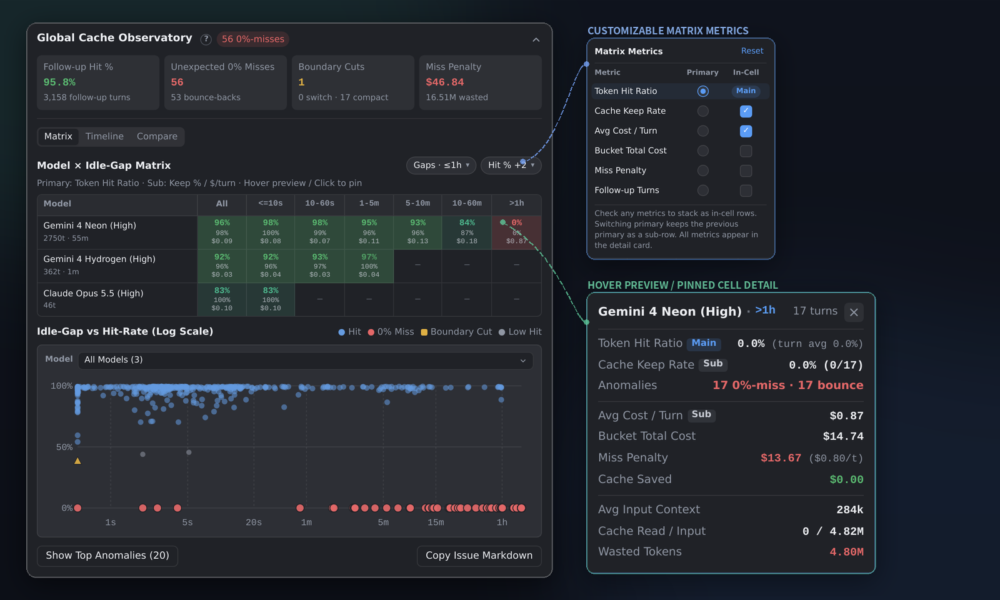

# Global Cache Observatory (Module #6)

**English** | [简体中文](zh-CN/cache-observatory.md) · [← Back to README](../README.md)

The **Global Cache Observatory** aggregates follow-up turns across all indexed Desktop and CLI sessions to diagnose prompt-cache stability, idle-gap decay, and transient cache drops.

  

---

## 1. Model × Idle-Gap Matrix

- **Configurable Idle-Gap Buckets**: Groups follow-up turns by the elapsed idle gap since the previous turn (e.g. `<=10s`, `10–60s`, `1–5m`, `5–10m`, `10–60m`, `>1h`), with customizable breakpoints saved in settings.
- **Customizable Cell Metrics**: Switch the primary heatmap metric (`Token Hit Ratio`, `Cache Keep Rate`, `Avg Cost / Turn`, `Bucket Total Cost`, `Miss Penalty`, `Follow-up Turns`) and stack any combination of secondary sub-metrics inside each cell.
- **Hover Preview & Pinned Cell Popover**: Hover any cell for instant stats or click to pin the full breakdown (`Token Hit Ratio`, `Keep Rate`, anomaly counts, wasted tokens, miss penalty, and cache saved).

## 2. Log-Scale Scatter, Time-Series & Period Compare

- **Idle-Gap vs Hit-Rate Scatter**: Plots every follow-up turn on a logarithmic idle-gap axis, color-coding normal hits, unexpected `0%` misses, boundary cuts, and low-hit turns.
- **Time-Series View (`1h / 5h / 1d / 7d`)**: Tracks cache hit trends over time while separating the active zone (`<=5m` idle) from long-idle cold misses.
- **Period Comparison**: Compare recent windows side by side (`Latest vs Prev`, `Last 24h vs Prev 3d`, `Recent 3`, or custom slices) with delta indicators.

## 3. Anomaly Classification & Sanitized Issue Export

To prevent false positives, AGY Lens classifies every miss before counting it as an anomaly:

- **Boundary Cuts (Excluded from Unexpected Misses)**: Model switches, account switches (in multi-account mode), and context compaction turns.
- **Unexpected `0%` Misses & Bounce-Back Detection**: Identifies turns where cache hit dropped to `0%` without a boundary event, and flags **Bounce-Back** cases where the immediately following turn recovered high cache reuse (typical of transient routing/cache-node misses).
- **Anonymized `Copy Issue Markdown`**: Exports a structured markdown diagnostic summary containing only aggregated stats, model IDs, idle-gap durations, and `provider_request_id` values—strictly stripping workspace paths, filenames, and conversation titles.
