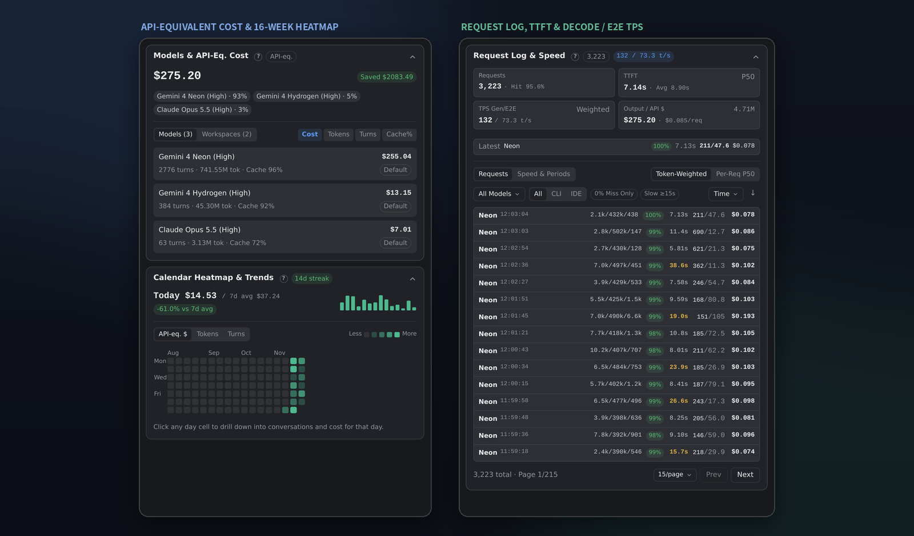

# Cost Analytics, 16-Week Heatmap & Request Speed (Modules #4, #5 & #8)

**English** | [简体中文](zh-CN/cost-and-speed.md) · [← Back to README](../README.md)

This guide covers API-equivalent cost accounting (**Module #4**), the 16-week usage calendar heatmap (**Module #5**), and the on-demand Request Log & Speed module (**Module #8**).

  

---

## 1. Models & Long-Context API-Equivalent Cost (Module #4)

- **Tiered Long-Context Pricing**: Automatically applies >200K input pricing tiers where applicable while keeping flat-1M models accurate (`Gemini 4 Neon`, `Claude Opus 5.5`, etc.).
- **Pure API Pricing Baseline**: Always computes pure API-equivalent USD cost (never multiplied by quota calibration factors) alongside estimated Prompt Cache savings.
- **Model & Workspace Views**: Switch between **By Model** and **By Workspace**, and sort by `Cost`, `Tokens`, `Turns`, or `Cache%`.

### Customizing Model Pricing

1. **Built-in Defaults**: Shipped in `sidecars/lens_panel/lib/pricing_defaults.json`.
2. **Optional Remote Sync**: Disabled by default; click **Sync Remote Pricing** (or enable auto-sync) in **Settings → Model Pricing** to pull public model rates.
3. **Local Overrides**: Edit any model's `input`, `output`, `cacheRead`, or long-context threshold right inside Settings; overrides persist in `pricing_overrides.json` inside your local sidecar data directory and survive plugin updates.

## 2. 16-Week Usage Calendar Heatmap (Module #5)

- **Daily Activity Heatmap**: Visualizes 16 weeks of usage across three switchable metrics: `API $`, `Tokens`, and `Turns`.
- **Today vs 7d Average & Streak**: Shows current-day spend against the 7-day rolling mean and consecutive active days.
- **Click-to-Drill-Down**: Click any day cell to inspect that day's per-conversation and per-model breakdown.

## 3. Request Log & Speed (Module #8)

- **On-Demand SQL Pagination (`GET /api/requests`)**: Keeps dashboard refreshes fast even with tens of thousands of turns; supports filtering by model, source (`Desktop` / `CLI`), `0%` misses, and slow requests, plus multi-column sorting.
- **Compact Single-Row Feed**: Displays `uncached / cacheRead / out`, cache hit %, `TTFT`, Decode & End-to-End `TPS`, and pure API cost on a single compact row; click any row to expand thinking/visible split, timing breakdown, cache saved, and `provider_request_id`.
- **Speed & Periods View**: Provides an orthogonal **`Token-Weighted` | `Per-Req P50`** aggregation switch, per-model speed comparisons, and `1h / 5h / 1d / 7d` period summaries (filtering out `<50ms` timing outliers).
