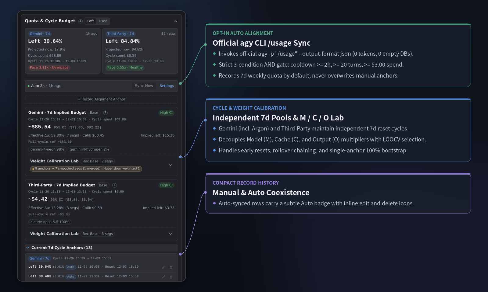

# Quota Alignment & Cycle Budget Calibration (Module #7)

**English** | [简体中文](zh-CN/quota-alignment.md) · [← Back to README](../README.md)

AGY Lens tracks independent weekly (`7d`) quota cycles for **Gemini** (including Argon) and **Third-Party** (Claude & GPT) pools, combining local API-equivalent spend with remaining-quota anchors to estimate implied cycle budgets and consumption pace.

  

---

## 1. Opt-In Auto Quota Alignment (Default OFF)

Available in **Settings → Auto Quota Alignment**, disabled by default until explicitly enabled.

- **Official Local CLI Only**: Runs `agy -p "/usage" --output-format json` via safe `execFile` (no shell interpolation, `windowsHide: true`, `cwd: os.tmpdir()`). Verified to consume `0` model tokens, create `0` conversation databases, never read OAuth credential files, and never probe undocumented local RPC endpoints.
- **Strict `num_turns === 0` Safety Guard & Multi-Layer Parser**: Rejects any response that executes a model turn; parses official JSON schemas (`groups[].buckets[]`, flat `buckets`, keyed `quota` map) with tabular/TUI text fallback.
- **Strict 3-Condition AND Activity Gate**: Background sync triggers only when **all three** conditions hold (all configurable):
  1. Cooldown elapsed (default `>= 2h`)
  2. New turns since last anchor/sync (default `>= 20`)
  3. New API-equivalent spend since last anchor/sync (default `>= $3.00`)
  - Zero calls while idle; exponential backoff on transient failures; automatically pauses within `±5m` of a multi-account switch point.
- **Cross-Platform Support**: Automatically resolves `agy` across macOS, Linux, and Windows (`PATH` + `.exe/.cmd/.bat` + OS fallback directories for minimal Desktop GUI environments), retries once without `ALL_PROXY` when HTTP + SOCKS proxies conflict, and shows OS-specific install & login instructions when the CLI is missing.
- **Manual Compatibility & Precision Protection**:
  - Defaults to recording `7d` weekly quota only (`5h` optional).
  - Tags automatic records with an `Auto` badge (`anchor_source = 'auto_agy_cli'`) and never overwrites or deletes manual anchors.
  - Protects `0.01%`-precision cycles from being degraded by coarse (`0.1%` / `1.0%`) fallback readings, deduplicates unchanged reads, and prioritizes manual explicit reset timestamps at equal precision.

## 2. Two-Pass `7d` Cycle Segmentation & Rollover

- **Dynamic Reset Inheritance**: Persists only explicit `reset_at` timestamps and derives cycle inheritance dynamically at read time; editing or clearing any anchor's reset time recomputes cycles immediately with zero stale copies.
- **Jitter Tolerance & Early-Reset Splitting**: Uses precision-interval intersection so coarse countdown jitter (`e.g. 6d 23h`) merges cleanly into one cycle, while official early resets (`<= W/2`) split cleanly into disjoint cycles without false `Reset conflict` warnings.
- **Rollover & Single-Anchor Bootstrap**: Expired cycles archive automatically while preserving the previous cycle's reference estimate; a single new-cycle snapshot can produce a conservative `100%` start bootstrap estimate (open upper CI bound) before switching smoothly to differential calibration.

## 3. Orthogonal 3-Factor Weight Calibration Lab (`M / C / O`)

- **Shared Base Anchors**: Shares default `1.00×` base models with `pricing_defaults.json` (`defaultAnchors`) and lets you switch the base model directly in the UI.
- **All-Subsets Model Selection**: Decouples **Model Multipliers (`M`)**, **Cache-Read Multiplier (`C`)**, and **Output Multiplier (`O`)** into three independent switches, evaluating all 8 subsets via profile-grid Huber-WLS, leave-one-out cross-validation (LOOCV), and `VIF < 10`.
- **Delta-Method Confidence Intervals**: Conservatively merges short settlement gaps / micro-rebounds and renders Observed vs. Predicted (`pp`) residual charts alongside 95% confidence intervals.
