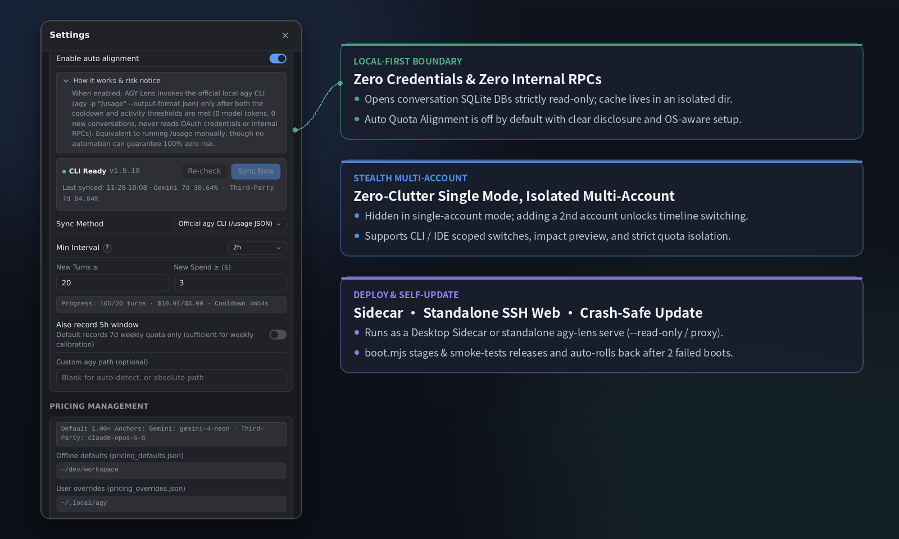

# Settings, Multi-Account, Auto-Update & Deployment

**English** | [简体中文](zh-CN/settings-and-deploy.md) · [← Back to README](../README.md)

This guide covers **Strictly Local Multi-Account Attribution**, **In-Panel Auto-Update**, **Standalone Web / SSH Deployment**, and **Local Data Architecture**.

<p align="center">
  
</p>

---

## 1. Strictly Local Manual Multi-Account (Zero-Clutter Stealth Mode)

AGY Lens never reads OAuth tokens or host logs to guess accounts.

- **Zero Extra UI for Single-Account Users**: No account filter or switch controls appear while only the default account exists.
- **Timeline Attribution**: Adding a 2nd account in **Settings → Accounts & Switch Timeline** unlocks the header account filter and Quick Switch popover:
  - Scope switches to `All`, `CLI only`, or `Desktop only`.
  - Backfill historical switch timestamps with **Preview Impact** before saving.
  - Override individual conversations or start a switch from a conversation's first turn directly on the Live Context card.
- **Strict Isolation**: Analytics, `5h`/`7d` quota cycles, anchor calibrations, and Cache Observatory boundary guards are strictly isolated per account and preserved across index rebuilds.

## 2. In-Panel Auto-Update & Crash-Safe Rollback

- **3 Policies (`Auto` | `Notify` | `Off`)**: Defaults to `Auto`—checks public GitHub Releases every 6h while active, downloads & smoke-tests (`AGY_LENS_SMOKE=1`) in an isolated subprocess, and applies cleanly on next cold start, after 10 minutes idle, or on explicit click. Set to `Off` for 100% offline operation.
- **Maintainer `manual-only` Tag**: Placing `<!-- agy-lens:manual-only -->` in a GitHub Release body skips auto-staging and header badges while keeping manual installation available in Settings.
- **Crash-Safe `boot.mjs`**: Applies staged files before `main.mjs` loads so frontend and backend stay version-locked; automatically rolls back to the previous backup after two consecutive startup failures, with a manual **Rollback** button in Settings.

## 3. Standalone Web Server & Headless SSH / CLI Mode

AGY Lens runs without Antigravity Desktop using Node.js 24+ built-ins only:

```bash
# Start local loopback web dashboard (default http://127.0.0.1:4318)
npx agy-lens serve

# Strictly read-only mode (blocks all mutating APIs with HTTP 403)
npx agy-lens serve --read-only

# Headless CLI status summary (JSON supported)
npx agy-lens status --json

# Reverse-proxy subpath deployment with token auth
npx agy-lens serve --base-path /lens --trust-proxy --token "$AGY_LENS_TOKEN"
```

Security defaults:
- Binds strictly to `127.0.0.1` unless overridden; guards against DNS rebinding and CWE-22 path traversal.
- Allows SSH port forwarding (`ssh -L 4318:127.0.0.1:4318 user@remote-host`) cleanly out of the box.

## 4. Local Architecture & Data Flow

```text
Antigravity Local Sources (Strictly Read-Only)
  ├── ~/.gemini/antigravity/conversations/*.pb / *.db      (Desktop)
  └── ~/.gemini/antigravity-cli/conversations/*.db         (CLI)
                         │
                         ▼  WAL-aware incremental mtime/size indexer
Local AGY Lens Data Dir (~/.gemini/antigravity/sidecar_data/agy-lens/lens_panel/data/)
  ├── telemetry_cache.db          (turns, accounts, switch intervals, quota_anchors)
  ├── settings.json               (UI prefs, module order, opt-in autoQuota config)
  ├── pricing_overrides.json      (user model pricing overrides)
  ├── auto_quota_state.json       (opt-in CLI probe/sync state & backoff)
  └── update_state.json           (in-panel updater metadata & rollback backups)
```

- Plugin code and user data are physically separated; updating or reinstalling the plugin never touches your telemetry cache, account timeline, or quota anchors.
- Optional **Auto Quota Alignment** (`enabled: false` by default) only invokes the local `agy` binary (`agy -p "/usage" --output-format json`) when explicitly enabled and gated.
