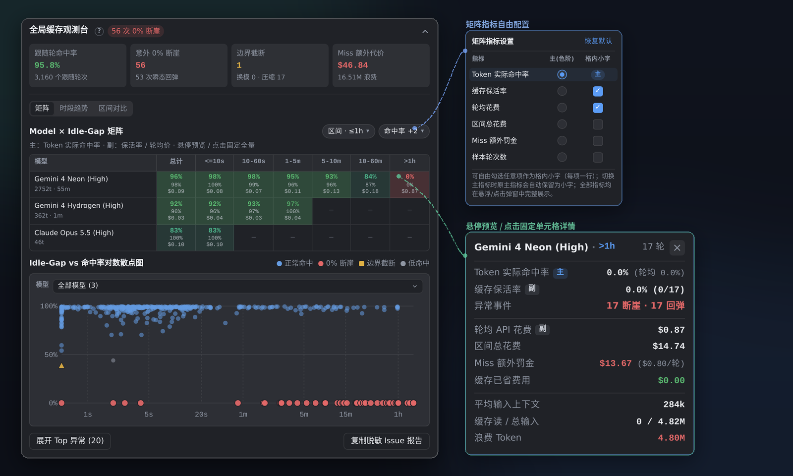

# 全局缓存观测台（模块 #6）

[English](../cache-observatory.md) | **简体中文** · [← 返回 README](../../README.zh-CN.md)

**全局缓存观测台**聚合所有已索引的 Desktop 与 CLI 会话中的跟随轮次，用于分析 Prompt Cache 稳定性、闲置时间衰减规律与瞬态断崖掉缓存。

  

---

## 1. Model × Idle-Gap 矩阵

- **可自定义闲置间隔分桶**：按距离上一轮回复的闲置时长分组（如 `<=10s`、`10–60s`、`1–5m`、`5–10m`、`10–60m`、`>1h`），支持在界面中自定义分界点并持久化保存。
- **单元格指标自由搭配**：可任选主指标（`Token 实际命中率`、`缓存保活率`、`轮均成本`、`分桶总成本`、`Miss 额外代价`、`跟随轮次`），并在单元格内叠加任意数量的副指标。
- **悬停预览与点击固定弹窗**：悬停任意格子即时预览，点击即可固定查看完整细分指标（命中率、保活率、异常次数、浪费 Token、Miss 代价与缓存节省）。

## 2. 对数散点图、时段趋势与区间对比

- **Idle-Gap vs 命中率对数散点图**：在对数时间轴上绘制每一条跟随轮次，以颜色区分正常命中、意外 `0%` 断崖、边界截断与低命中样本。
- **时段趋势视图（`1h / 5h / 1d / 7d`）**：按时间追踪命中率走势，并将 `<=5m` 活跃区与长闲置冷启动明确拆开。
- **区间对比视图**：支持「最新 vs 上一周期」「近 24h vs 前 3 天」「近 3 期」或自定义区间横向对比。

## 3. 异常分类与脱敏 Issue 导出

为避免误报，AGY Lens 会在统计异常前先自动分类每一次未命中：

- **边界截断（不计入意外未命中）**：模型切换、多账号切换及上下文压缩触发的正常前缀重置。
- **意外 `0%` 断崖与瞬态回弹识别**：捕捉无边界事件却跌至 `0%` 的异常轮次，并标记下一轮立即恢复高命中的**瞬态回弹（Bounce-Back）**样本。
- **一键复制脱敏 Issue 报告**：输出结构化 Markdown 诊断摘要，仅保留聚合指标、模型 ID、闲置间隔与 `provider_request_id`，自动剥离工作区路径、文件名与会话标题。
