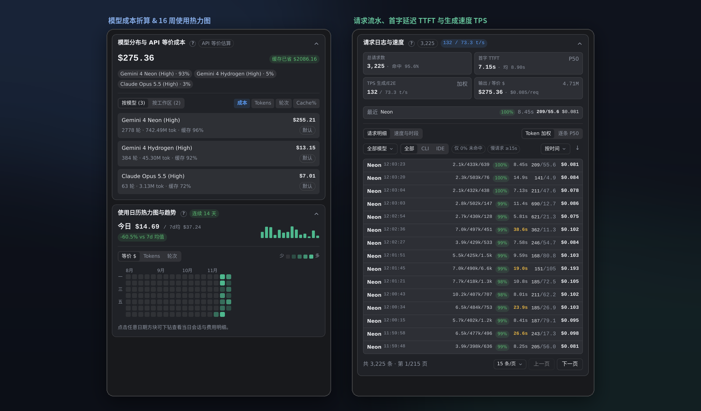

# 成本折算、16 周热力图与请求速度（模块 #4、#5 与 #8）

[English](../cost-and-speed.md) | **简体中文** · [← 返回 README](../../README.zh-CN.md)

本文介绍 API 等价成本统计（**模块 #4**）、16 周使用日历热力图（**模块 #5**）以及按需分页的请求日志与速度模块（**模块 #8**）。

  

---

## 1. 模型分布与长上下文 API 等价成本（模块 #4）

- **长上下文阶梯计费**：对适用模型自动按 >200K 输入阶梯单价计费，同时对全量 1M 平价模型（如 `Gemini 4 Neon`、`Claude Opus 5.5`）准确按标准价计算。
- **纯 API 基准口径**：始终以纯官方 API 等价美元计算（绝不乘以额度校准倍率），并同步展示 Prompt Cache 节省金额。
- **双维度切换与排序**：支持按**模型**或按**工作区**分组，支持按 `成本`、`Tokens`、`轮次`、`Cache%` 排序。

### 自定义模型定价

1. **内置离线默认表**：随插件内置于 `sidecars/lens_panel/lib/pricing_defaults.json`。
2. **可选远程同步**：默认关闭；可在 **设置 → 定价表管理** 手动点击同步或开启自动同步，拉取公开模型单价。
3. **本地覆写**：可直接在设置面板内编辑任意模型的 `Input`、`Output`、`Cache Read` 及长上下文阈值，保存在本地数据目录的 `pricing_overrides.json` 中，插件更新时完整保留。

## 2. 16 周使用日历热力图（模块 #5）

- **三指标切换**：按天绘制最近 16 周的使用密度，支持在 `等价 $`、`Tokens`、`轮次` 间切换。
- **今日对比与连续天数**：展示今日用量相对 7 天均值的变化幅度与连续活跃天数。
- **点击下钻**：点击任意日期方块即可展开查看当天的分会话与分模型明细。

## 3. 请求日志与速度（模块 #8）

- **按需 SQL 分页（`GET /api/requests`）**：即便累计上万轮记录也不拖慢主面板刷新；支持按模型、来源（`桌面端` / `CLI`）、`0%` 未命中、慢请求筛选及多字段排序。
- **单行紧凑流水**：一行展示 `未缓存 / 缓存读 / 输出`、命中率、首字耗时 `TTFT`、纯生成 & 端到端 `TPS` 与纯 API 成本；点击单行展开思考/可见输出拆分、耗时构成、缓存节省与 `provider_request_id`。
- **速度与时段子视图**：提供正交的 **`Token 加权` | `逐条 P50`** 聚合切换、分模型速度对比及 `1h / 5h / 1d / 7d` 时段汇总（自动过滤 `<50ms` 异常耗时点）。
