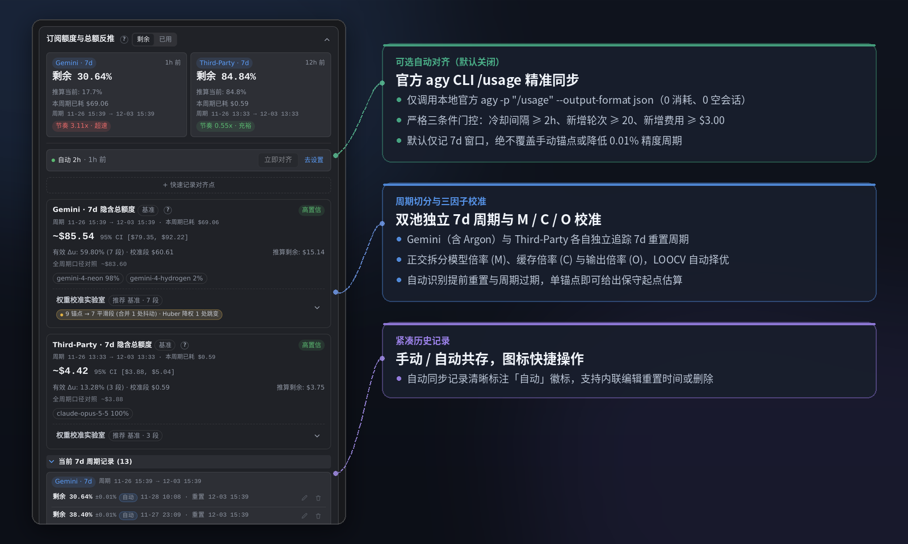

# 额度对齐与周期总额校准（模块 #7）

[English](../quota-alignment.md) | **简体中文** · [← 返回 README](../../README.zh-CN.md)

AGY Lens 为 **Gemini**（含 Argon）与 **Third-Party**（Claude & GPT）分别维护独立的 `7d` 周周期，结合本地 API 等价消耗与 2 位小数剩余额度快照，估算隐含周期总额度与消耗节奏。

  

---

## 1. 可选自动额度对齐（默认关闭）

位于 **设置 → 自动额度对齐**，默认关闭，仅在用户主动开启后生效：

- **仅调用本机官方 CLI**：通过安全的 `execFile` 执行 `agy -p "/usage" --output-format json`（无 shell 拼接、`windowsHide: true`、`cwd: os.tmpdir()`）。实测消耗 `0` 模型 Token、产生 `0` 个新会话库、不读取 OAuth 凭据文件、不探测未公开内部 RPC 接口。
- **`num_turns === 0` 硬闸门与多层回退解析**：若未来版本导致 `/usage` 退化为模型轮次，解析器会直接拦截报错；优先解析官方 JSON 结构（`groups[].buckets[]`、平铺 `buckets`、`quota` 映射），并内置表格/TUI 文本回退解析。
- **严格三条件 AND 活动门控**：后台自动同步必须**同时满足**以下三项才触发（均可在设置中自定义）：
  1. 冷却间隔已满（默认 `≥ 2h`）
  2. 自上次快照/同步以来的新增轮次（默认 `≥ 20` 轮）
  3. 自上次快照/同步以来的新增 API 等价费用（默认 `≥ $3.00`）
  - 闲置期间零调用；网络异常按指数退避；多账号模式下距切号点不足 5 分钟自动暂缓。
- **全平台兼容与安装引导**：自动兼容 macOS、Linux 与 Windows（自动解析 `PATH`、`.exe/.cmd/.bat` 及桌面端极简环境变量下的常见安装目录），自动处理 HTTP + SOCKS 代理冲突导致的 `EOF` 重试，未安装 CLI 时提供对应系统的安装命令复制与登录提示。
- **与手动记录无缝共存**：
  - 默认仅记录 `7d` 周窗口（`5h` 窗口可选开启）。
  - 自动写入行带有轻量「自动」标识（`anchor_source = 'auto_agy_cli'`），绝不覆盖或删除手动记录。
  - 自动保护 `0.01%` 高精度周期不被低精度（`0.1%` / `1%`）文本回退污染，自动跳过零变化重复写入，且同精度下手动显式重置时间优先级不低于自动记录。

## 2. 两遍 `7d` 周期切分与滚动衔接

- **动态重置时间继承**：数据库仅持久化显式重置时间，继承关系在读时动态推导；内联修改或清空任意记录的重置时间都会即时重算，不留脏副本。
- **倒计时抖动收敛与提前重置切分**：通过精度区间交集吸收粗粒度倒计时抖动（如 `6d 23h`），同时正确识别官方提前重置（`≤ W/2`）并无告警切分新旧周期。
- **过期归档与单快照起点估算**：周期过期后自动归档旧锚点并保留上周期参考估值；新周期仅录 1 条快照时自动以起点 `100%` 给出保守初估，累计足够有效消耗后平滑切回纯差分校准。

## 3. 正交 3 因子权重校准实验室（`M / C / O`）

- **共享基准模型**：与 `pricing_defaults.json` 的 `defaultAnchors` 共用 `1.00×` Base 基准模型，可在面板内自由切换。
- **全子集自动择优**：将**模型倍率（`M`）**、**缓存倍率（`C`）**与**输出倍率（`O`）**解耦为 3 个独立开关，全枚举 8 个子集，结合剖面网格 Huber-WLS、留一交叉验证（LOOCV）与 `VIF < 10` 自动择优。
- **置信区间与残差图**：保守合并短间隔结算滞后与微回弹抖动，提供 95% 置信区间及实测 vs 预测（`pp`）残差对比图。
