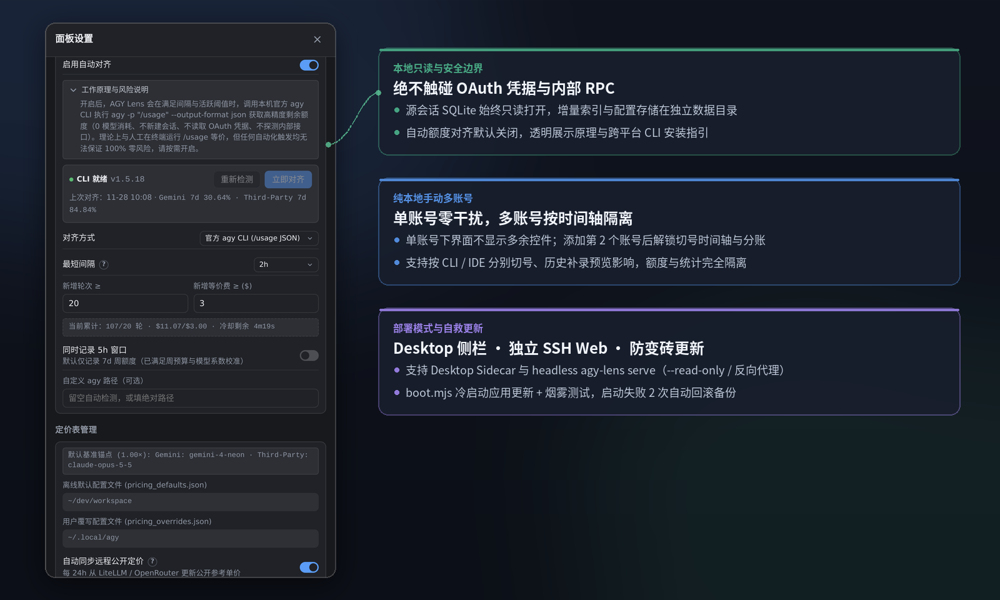

# 设置、多账号分账、自动更新与独立部署

[English](../settings-and-deploy.md) | **简体中文** · [← 返回 README](../../README.zh-CN.md)

本文介绍 **纯本地手动多账号**、**面板内自动更新**、**独立 Web / SSH 无桌面部署**与**本地数据架构**。

<p align="center">
  
</p>

---

## 1. 纯本地手动多账号（单账号默认静默）

AGY Lens 绝不通过读取 OAuth 凭据或宿主日志来猜测账号：

- **单账号零额外控件**：仅存在默认账号时，顶栏不会显示多余的账号筛选或切号按钮。
- **切号时间轴归属**：在 **设置 → 多账号与切号标注** 添加第 2 个账号后，自动解锁顶栏筛选与快速切号弹窗：
  - 支持按 `全部`、`仅 CLI`、`仅 Desktop` 分别切号。
  - 支持历史补录切号时间，保存前可一键**预览影响**（受影响轮次与会话数）。
  - 支持在实时上下文卡片上直接改绑单会话归属，或从某会话起点开始切号。
- **严格隔离与持久化**：统计分析、`5h`/`7d` 额度周期、锚点校准与缓存观测台跨号切换防护均按账号完全隔离，重建索引时完整保留。

## 2. 面板内自动更新与崩溃自动回滚

- **三档更新策略（`自动更新` | `仅提醒` | `关闭`）**：默认 `自动更新`——面板活跃时每 6h 检查一次公开 GitHub Releases，在隔离进程预下载并通过烟雾测试（`AGY_LENS_SMOKE=1`），随后在下次冷启动、闲置 10 分钟或手动点击后平滑应用；切为 `关闭` 即 100% 离线。
- **`manual-only` 小更新标记**：维护者在 GitHub Release 正文中放入 `<!-- agy-lens:manual-only -->` 即可跳过自动推送与顶栏徽标，仅在设置中按需手动升级。
- **防变砖 `boot.mjs` 引导**：文件替换在 `main.mjs` 加载前完成，杜绝前后端版本错位；若新版本连续 2 次启动失败会自动从备份回滚，设置中也提供手动回滚按钮。

## 3. 独立 Web 服务与 Headless SSH / CLI 模式

无需 Antigravity Desktop，仅依赖 Node.js 24+ 即可独立运行：

```bash
# 启动本地回环 Web 面板（默认 http://127.0.0.1:4318）
npx agy-lens serve

# 严格只读模式（所有写接口统一返回 HTTP 403）
npx agy-lens serve --read-only

# 无界面 CLI 汇总状态（支持 JSON）
npx agy-lens status --json

# 反向代理子路径 + Token 鉴权部署
npx agy-lens serve --base-path /lens --trust-proxy --token "$AGY_LENS_TOKEN"
```

默认安全策略：
- 默认严格绑定 `127.0.0.1`，内置 DNS Rebinding 与路径穿越防护。
- 开箱支持 SSH 端口转发（`ssh -L 4318:127.0.0.1:4318 user@remote-host`）。

## 4. 本地数据流架构

```text
Antigravity 本地源库（严格只读）
  ├── ~/.gemini/antigravity/conversations/*.pb / *.db      (Desktop)
  └── ~/.gemini/antigravity-cli/conversations/*.db         (CLI)
                         │
                         ▼  WAL 感知增量 mtime/size 索引器
AGY Lens 独立本地数据目录（~/.gemini/antigravity/sidecar_data/agy-lens/lens_panel/data/）
  ├── telemetry_cache.db          (turns、账号、切号区间、quota_anchors)
  ├── settings.json               (界面偏好、模块顺序、可选 autoQuota 配置)
  ├── pricing_overrides.json      (用户自定义模型单价覆写)
  ├── auto_quota_state.json       (可选 CLI 探测/同步状态与退避记录)
  └── update_state.json           (面板更新状态与回滚备份索引)
```

- 插件代码目录与用户数据目录物理隔离，升级或重装插件绝不触碰本地索引、多账号记录与额度锚点。
- 可选的 **自动额度对齐** 默认关闭，仅在主动开启并满足门控条件时调用本机官方 `agy` 可执行文件。
